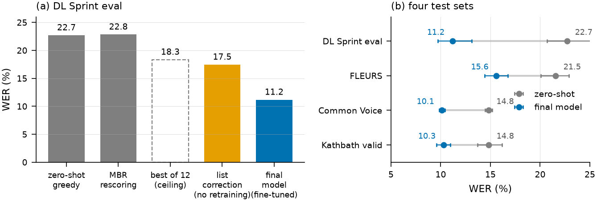
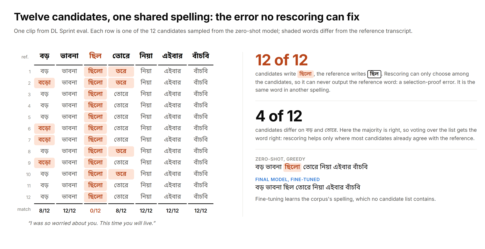
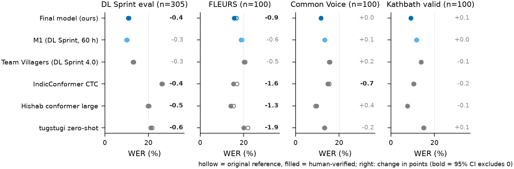
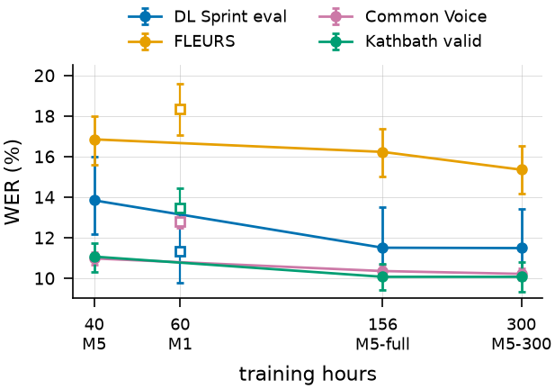
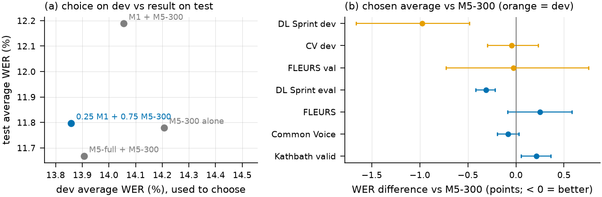
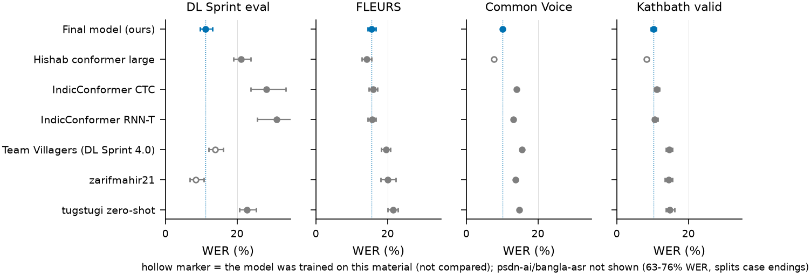
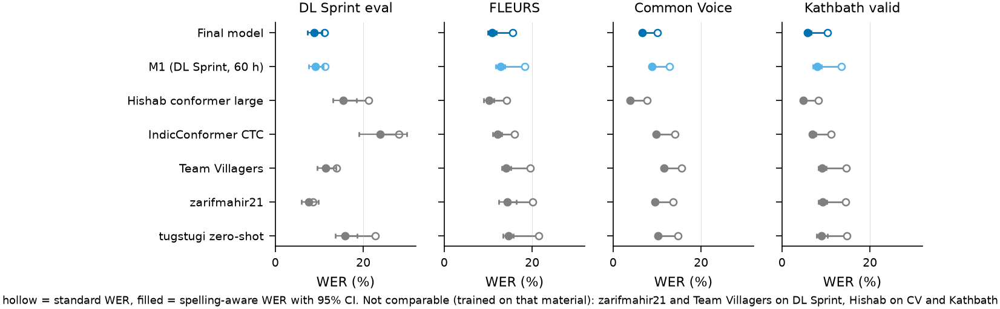

# Why N-best Rescoring Plateaus for Bangla Speech Recognition, and How Far Fixing the Cause Goes

**CSE499 capstone, North South University.** Team: Mehboob Ehsan Khan, Nabigah Bin Sayeed, Nafisa Rodela.
Supervisor: Dr. Nabeel Mohammed.

*This README is the paper. Every number comes from a result file in this repository's pipeline, with 95%
cluster-bootstrap confidence intervals. All experiments are complete (October 2026).*

## At a glance

- **Problem.** For Bangla media speech (drama, narration, news), choosing among a Whisper model's candidate
  transcripts (N-best rescoring) stops helping early. We ask why, and whether fixing the cause helps.
- **Why it stalls.** Most remaining errors are in *every* candidate, so no selection rule can recover them, and
  about 41% of errors are the same word in another spelling or dialect form (ছিল/ছিলো, কি/কী).
- **Fixing the cause.** On our held-out media test set (DL Sprint eval), word error rate (WER) falls from 22.71%
  to 17.46% by adding learned spelling variants to the candidate list (no retraining of the speech model), and to
  11.34% by fine-tuning on 60 h of in-domain speech.
- **Across corpora.** Each public corpus trains its own test set best; 10 h from each of four corpora gives the
  best average over the four test sets (13.18%).
- **Final model.** One Whisper-medium trained on all of it (~300 h), with a weight average chosen on dev data:
  11.18% on DL Sprint eval and 11.80% averaged over four test sets (zero-shot: 22.70% and 18.46%). It is the best open
  model we scored on every clean test set except FLEURS, where Hishab's non-commercial conformer leads by 1.4 points.

<p align="center"></p>

**Summary figure.** (a) Rescoring the zero-shot model's candidates does not beat greedy decoding, and even a perfect
selector stops at 18.3%; adding the missing spelling variants to the list (no retraining) and fine-tuning attack the
cause. (b) The final model on the four test sets, with 95% confidence intervals.

| Part | Status |
|---|---|
| 499A (Sept 2026): first rescoring study | done |
| 499B: rebuilt evaluation, diagnosis, list correction, fine-tuning, train × test matrix (§3–5) | done |
| Human verification of the references (§5.11) | done |
| Final model on all four corpora (156 h, then ~300 h), whole-recording evaluation (§5.12) | done |
| Comparison with other open Bangla models (§5.13) | done |
| Results frozen / final report | Nov 12 / Dec 1, 2026 |
| Public release of the model, segmentation and scoring code on Hugging Face | planned; not yet published |

**Links:** [Bangla subtitle demo](https://asr-phi.vercel.app) · [Setup](#setup) · [Data](#data) ·
[Reproducing](#reproducing) · [All results](results/)

<p align="center"></p>

**Figure 1.** Overview. Data preparation (grey), the diagnosis of the plateau (blue), the two ways of fixing
the cause (orange: change the candidate list; green: change the model), and the work still running (dashed).
Editable source: `figures/pipeline_overview.drawio`.

---

## Abstract

N-best rescoring is a cheap way to improve a speech recognizer without retraining, but for Bangla media
speech (drama, narration, news) its benefit stalled at a fraction of the oracle gap. We rebuilt the
evaluation of a Bangla Whisper-medium model around forced-aligned references and a frozen scoring
harness, and found that the apparent gain of Minimum Bayes Risk (MBR) selection came from comparing
against a sampled candidate: against greedy decoding, MBR changes word error rate (WER) by +0.14 points
(95% CI −0.11 to +0.35), although a perfect selector would gain 4.12 points. Counting, for every reference
word, how many of 12 candidates contain it explains the gap: 57% of greedy errors appear in no candidate,
and MBR fixes an error only when most candidates already agree. About 41% of errors are the same word in
another spelling or dialect form, and the candidates share these errors far more often than other errors;
the pattern holds on FLEURS, Kathbath and a
second model, and accounts for the whole lead of a stronger open baseline. Adding learned spelling
variants to the candidate lists moves the oracle from 18.35% to 13.75% and the WER from 22.71% to 17.46%
without retraining the speech model (only a word n-gram LM and spelling rules built from the training text); fine-tuning the model on 60 h of in-domain data reaches **11.34%** (−11.36 points
[−12.32, −10.46]), and five predictions derived from the diagnosis all hold. A train × test matrix
over four public corpora shows that each corpus trains its own test set best, and that 10 h from each of
four corpora gives the best average over the four test sets (13.18% vs 13.99% for the in-domain model); with every
hour of the four corpora plus 144 h of public read speech (300 h), one model of the same size and speed reaches an
average of 11.78% while matching the in-domain model on DL Sprint (11.49%), and averaging its weights with the in-domain
model, chosen on development data, gives **11.18%** on DL Sprint and an average of **11.80%**. Against every open Bangla
model we scored, the final model is best on every clean test set except FLEURS, where a non-commercial conformer leads
by 1.4 points. After
fine-tuning, rescoring gains almost vanish (−0.45 points): training removes exactly the errors that
selection could reach. Against 605 human-verified references, about 2% of the media reference words are wrong, most
errors that no candidate contains are spelling, dialect or transcript errors rather than recognizer errors, and every
model's WER changes by less than 2 points; not counting confirmed spelling differences (15–50% of a system's
errors) leaves the conclusions unchanged. We release the forced-aligned segmentation of 93.1 hours of Bengali-Loop
recordings, the verified references and the scoring code.

**Keywords:** speech recognition, Bangla, N-best rescoring, minimum Bayes risk, error analysis, spelling variation, Whisper

---

## 1. Introduction

Rescoring is one of the cheapest ways to improve a speech recognizer. The model produces several candidate
transcripts for each utterance, and a second rule chooses among them, so accuracy can improve without
retraining. The upper bound is the *oracle*: the candidate with the fewest errors, chosen with access to the
reference. For Bangla media speech, our earlier work (499A) reported that MBR selection closes about 41% of
the gap between the first candidate and the oracle, and then stops: more candidates, other temperatures and
a learned reranker barely moved it. This work asks why it stops, and whether removing the cause helps.

Bangla makes the question interesting. Many common words have more than one accepted spelling
(ছিল/ছিলো, কি/কী), spoken forms differ from standard writing (নিয়া for নিয়ে), and public corpora
follow different conventions. The model we study is a Whisper-medium checkpoint fine-tuned by Bengali.AI on
regional Bangla. Its decoder has learned a spelling habit. If every candidate shares that habit, the
reference spelling is never in the list, and no selection rule can recover it, however good.

In practice the hard part was measurement, not modeling. The earlier evaluation clips had been selected by
the very model being evaluated; the text normalizer left punctuation that turned one word into two errors;
the "first candidate" was a random sample rather than the model's best guess; and the candidate scores used
by MBR were silently wrong under the current toolkit. Each of these changed the conclusion, so the study
rebuilds the evaluation first and then diagnoses the plateau with a count anyone can reproduce: for every
reference word, how many of the candidates contain it.

**Contributions.**
- **A corrected measurement of rescoring for Bangla:** forced-aligned references chosen without the
  evaluated model, a frozen normalizer and harness with cluster-bootstrap intervals, and the finding that
  MBR does not beat greedy decoding on media speech (it helps slightly on read speech).
- **A diagnosis of the plateau:** per-word candidate agreement separates errors no selector can reach
  (57% of greedy errors) from errors MBR out-votes; rule-based typing shows that about 41% of errors are
  spelling or dialect variants, across two models and three test sets.
- **A reference-free signal:** candidate agreement alone flags erroneous words (AUROC 0.823), and spelling
  errors are the ones on which all candidates agree.
- **Tests of the diagnosis:** hypothesis expansion with a learned convention rewriter and an n-gram LM, and
  an error-locus comparison of LoRA, decoder-only, encoder-only and full fine-tuning against five
  predictions derived from the diagnosis.
- **Released resources:** the forced-aligned segmentation of the DL Sprint / Bengali-Loop recordings, 605
  human-verified references with agreement statistics (`results/labels/verified_references.csv`), and the
  normalizer and scoring code.

---

## 2. Background and related work

**Bangla media-speech data and systems.** The BUET DL Sprint 4.0 competition released transcribed
recordings of public Bangla media, later published as the Bengali-Loop benchmark [1]. We use its training
recordings as our media-speech data; because the competition test transcripts are hidden, our media-speech
test set is a group of held-out training recordings. Competition systems fine-tuned the same Bengali.AI
Whisper-medium checkpoint we study and added source separation, voice-activity windowing or careful
chunking [2, 3]; the strongest, ShobdoSetu, reaches 15.55% WER on the hidden test [4]. These papers report how
low WER goes, not which errors remain. For read speech, Vistaar evaluated Indian-language models on
Kathbath, FLEURS and Common Voice [5], and Voice of India reports open and commercial systems on a Bengali
benchmark [6]; commercial systems lead there, so every claim here is scoped to *open* models on our test sets.

**N-best rescoring and its ceiling.** MBR selects the candidate with the lowest expected loss against the
others and remains competitive for Whisper [7]. The closest analysis is Novosad's decomposition of the oracle
gap of English CTC models [8]: MBR over the model's own posteriors gives nothing, while MBR weighted by an
external language model helps. PERL measured, for Chinese, how often the correct character appears among the
candidates for each 1-best error [9]; our per-word agreement count is the same coverage idea at word level,
and we add the linguistic types of the uncovered errors and their link to MBR's behavior.

**Expanding the candidate list.** Guo et al. applied a text-trained spelling corrector to every candidate
and halved the oracle WER [10]; generative error correction rewrites N-best lists with large language
models [11]. Expansion is therefore not new; we use it as a controlled test of the diagnosis.

**Spelling variation and evaluation.** Several works change the metric instead of the model: unsupervised
WER standardization [12] and Vimarsha's lattice of valid spellings for Indian languages [13]. Whisper's
default normalizer removes Indic vowel signs [14]. We do not propose a metric: we keep strict WER, publish
our normalizer, and use spelling analysis to explain rescoring and fine-tuning behavior.

**Fine-tuning Whisper.** On DL Sprint data, Bangla-WhisperDiar reports 31.32% WER with LoRA and 24.41% with
full fine-tuning [3]. A study on Russian found that Whisper fine-tuning gains vanish when the test set
accepts multiple spellings [15]. We use the LoRA / decoder-only / encoder-only / full contrast diagnostically,
to locate which part of the network fixes which error type.

---

## 3. Method

Figure 1 (top of the page) shows the whole pipeline.

### 3.1 Forced-alignment segmentation
Each DL Sprint recording comes with one untimed transcript for 40–86 minutes of audio. The earlier pipeline
cut audio at pauses, transcribed each piece with the evaluated model and fuzzy-matched that guess against
the transcript, discarding poor matches: it lost 27% of the audio and let the model under test choose its
own test clips. We replace it with forced alignment: transcripts are romanized with uroman and aligned with
the MMS aligner (a multilingual wav2vec 2.0 CTC model, used only as an alignment tool). Anchors (character
8-grams that occur exactly once in the romanized transcript and once in the aligner's own greedy
transcription, kept as a monotonic chain) split each recording into pieces that are aligned independently,
with a wildcard token at both ends to absorb untranscribed audio (ads, music). Words are grouped into clips of
at most 25 s, cut at the longest inter-word pause; each clip's reference is exactly the transcript words
inside it. Clips are filtered only by the aligner's confidence, never by a recognizer we evaluate.
Segmentation yields **24,156 clips (93.1 h) from 112 recordings**. The confidence filter (mean word posterior
≥ 0.5, at most half of the words below 0.4, 1–25.5 s) keeps 20,272 clips (79.2 h, §4): it drops 16% of the clips
and 15% of the audio, against the 27% of the audio the earlier pipeline lost, and the choice is made by the
aligner, not by a model we evaluate.

### 3.2 Normalization and scoring harness
Hypotheses and references are normalized identically: Unicode NFC; one form for the nukta letters
(ড়, ঢ়, য়); removal of Bangla and Latin punctuation including hyphens, quotes, brackets and speaker marks;
whitespace collapsed. Vowel signs, virama and chandrabindu are never removed. WER is computed at corpus level,

$$\mathrm{WER} = \frac{\sum_u (S_u + D_u + I_u)}{\sum_u N_u},$$

and confidence intervals come from a cluster bootstrap over recordings (speakers or sentences for read
speech), 1,000–2,000 resamples; a comparison resamples both systems together and reports the paired
difference. Under this normalizer, the 499A 1-best / MBR / oracle WERs of 34.85 / 32.29 / 28.72% become
26.98 / 24.35 / 20.57% for the identical outputs (the earlier rule stripped only five punctuation marks).

### 3.3 Candidates, exact scores and MBR
Greedy decoding (batch 8, fp16) is the baseline for every comparison. For rescoring, the model produces 12
candidates by beam-search multinomial sampling (T = 0.7). Each candidate's score is its exact log-probability
under the model, recomputed by teacher forcing (the generation toolkit no longer returned usable beam
scores). MBR selects

$$\hat{h} = \arg\min_{h_i} \sum_{j \ne i} P(h_j \mid x)\, \mathrm{WER}(h_i, h_j),$$

with $P(h_j \mid x)$ a softmax of the candidate scores at temperature τ = 0.5.

### 3.4 Candidate-agreement anatomy
For each reference word $r_i$ we count $c_i$, the number of the $K = 12$ candidates in which it is aligned
as correct. A word with $c_i = 0$ is **selection-proof**: no candidate contains it, so no rule that chooses
among candidates can recover it. Without a reference, the same count on the greedy output ($a_j$ = number of
candidates containing greedy word $j$) is an error detector, scored by AUROC.

### 3.5 Error typing
Each error gets one type by rules on a folding key that maps common spelling variants to one form (final ো,
ি/ী, ু/ূ, chandrabindu, য়/য, ঙ/ং, hasanta): *convention* (ছিল/ছিলো, কি/কী), *vowel shift* (নিয়ে/নিয়া,
তোমার/তুমার), *segmentation* (দু পাশে/দুপাশে), near miss, substitution, number, deletion, insertion. The
first three form the **variant share**. The rules are proxies; human labels measure their precision
(§5.11).

### 3.6 List correction: raising the ceiling without retraining
Each clip's pool is the 12 sampled candidates plus the greedy output, scored by

$$s(h) = \log P_{\mathrm{AM}}(h \mid x) + \lambda \log P_{\mathrm{LM}}(h) + \beta |h|,$$

with a word n-gram LM (interpolated Kneser–Ney) trained only on the DL Sprint training references. Methods:
LM reranking; LM-weighted MBR; ROVER-style word voting; a convention rewriter (rules "model writes w,
reference writes w′" learned from greedy-vs-reference alignments on the training split); and **expansion**,
where each candidate's rewrite joins the pool with its parent's acoustic score and the LM chooses the
spelling. Every weight, threshold and the LM order is chosen on the development split only and applied
unchanged to every test set; human labels are never used.

### 3.7 Fine-tuning
The model is fine-tuned on the cleaned DL Sprint training clips (15,325 clips, 59.6 h; bracketed tags
stripped, 67 clips with non-Bangla script dropped) in four ways: LoRA (rank 32 on every attention and MLP
projection of encoder and decoder, lr 2e-4), decoder only, encoder only, and all weights (lr 1e-5); AdamW,
batch 8×4, 2 epochs, bf16 autocast, gradient checkpointing. We add no SpecAugment of our own: the trainer keeps
the checkpoint's `apply_spec_augment` setting, and Hugging Face Whisper masks input features during training only
when that flag is true (`mask_time_prob` 0.05 is the library default and has no effect otherwise). **From the
diagnosis we derived five predictions:**
- **P1** the best variant beats the strongest open zero-shot model (Hishab, 21.18%) on DL Sprint eval;
- **P2** at least half of the WER reduction comes from variant types;
- **P3** FLEURS improves less than DL Sprint eval;
- **P4** decoder-only reaches at least 80% of the best variant's gain;
- **P5** the variant share of the remaining errors falls below the zero-shot share (40.6%).

### 3.8 Failures found during development
Several conclusions changed while the evaluation was being rebuilt; each failure became a check.

| Failure | Evidence → correction → check |
|---|---|
| Normalizer | 499A WER 34.85% reproduced by stripping five marks only → full punctuation removal → frozen normalizer |
| Model-gated clips | eval clips kept only if the evaluated model matched them → forced alignment, aligner-only filter |
| Aligner drift | one drama aligned 1,408 of 4,578 words → anchor-based alignment → per-recording aligned-word counts |
| Weak baseline | "1-best" was a sampled candidate, worse than greedy → every comparison paired against greedy |
| Candidate scores | toolkit no longer returned beam scores; fallback read the wrong beams → exact teacher-forced scores |
| Spelling rule | folding merged different words (আর/আরো) → exceptions and a stricter vowel-shift rule → regression tests |
| Token limit | one transcript re-tokenized to 499 tokens crashed GPU scoring → truncation with a flag |
| Batch effect | greedy output differs between batch 1 and 8 → batch 8 for every row |
| GPU type | rows from different GPUs mixed → same-GPU baseline re-score (A100 vs RTX 3060: 96–99% identical hypotheses, WER within 0.02) |

---

## 4. Experimental setup

**Data splits** (forced-aligned DL Sprint, by recording):

| Split | Recordings | Clips | Hours |
|---|---:|---:|---:|
| Train | 83 | 15,392 | 59.92 |
| Development | 6 | 646 | 2.39 |
| Evaluation | 22 | 4,234 | 16.85 |

Clips and hours are after the aligner-confidence filter (§3.1): 20,272 of the 24,156 segmented clips. A recording
is counted when at least one of its clips is kept, so the table lists 111 of the 112 segmented recordings: every
clip of the remaining one fell below the filter.

The split is disjoint by recording but not by speaker or series: some narrators and serialized stories appear
on both sides. **Public test sets:** FLEURS-bn test (920 utterances, read Wikipedia), Kathbath validation
(2,236; the public repository has no test split), Common Voice 27.0 test (9,408 clips). None is used for
training or tuning.

**Contamination.** Hishab's model card lists Kathbath and Common Voice among its training data, and it
transcribes 50.9% and 61.5% of those utterances exactly; BanglaASR, fine-tuned on Common Voice, does so for
59.1%. These rows are marked † and never compared.

**Hardware.** Zero-shot, rescoring and list-correction inference on one RTX 3060 (12 GB); fine-tuning training and scoring on a
Modal A100-40GB, the M1 rows and the zero-shot baseline scored on that same GPU; the matrix models (§5.8),
LoRA's Kathbath and Common Voice rows and the stacking candidates on Kaggle T4s, which give the same WER as
the A100 within 0.01 points (zero-shot tugstugi on dev, FLEURS and Kathbath; 96–99% identical outputs); the Hishab
baseline on a Kaggle T4. Budget: $0 out of pocket (free cloud credits).

---

## 5. Results

<p align="center"></p>

**Figure 2.** All systems on all test sets: WER with 95% cluster-bootstrap CIs. Grey = zero-shot, orange = the
list-correction system (speech model not retrained), blue = fine-tuned on DL Sprint train (M1). Hollow markers: the test set is in that
model's declared training data (not compared). Whisper large-v3 / turbo (80–93% WER) are off the scale.
Zero-shot and list-correction rows were scored on an RTX 3060, fine-tuned rows on an A100 (the same model gives the same
WER within 0.02 points on both).

### 5.1 Zero-shot baselines
WER (%), greedy decoding, one normalizer. † = the model's declared training data includes this test set.

| Model | DL Sprint eval | FLEURS | Kathbath | Common Voice |
|---|---:|---:|---:|---:|
| Hishab conformer large (CTC, ~120M, CC-BY-NC) | **21.18** | **14.24** | 8.32† | 7.72† |
| tugstugi Whisper-medium (764M, Apache-2.0) | 22.71 [20.55, 25.26] | 21.54 | **14.79** | **14.81** |
| IndicWav2Vec (bn) | 42.80 | 28.18 | 22.15 | 25.80 |
| BanglaASR (Whisper-small) | 58.20 | 32.94 | 32.20 | 9.66† |
| wav2vec2-xls-r-300m-bengali | 65.20 | 47.46 | 38.57 | 43.35 |
| Whisper large-v3 | – | 79.89 | 93.24 | – |
| Whisper large-v3-turbo | – | 91.54 | 92.64 | – |

Generic Whisper models write Bangla partly in Devanagari zero-shot and are not usable without adaptation.

### 5.2 Rescoring against greedy decoding
WER points, system − greedy, 95% cluster-bootstrap CI for eval. *Sel.-proof* = share of greedy's errors that
no candidate contains; *Variant* = spelling/dialect share of greedy's errors (rule-based).

| Condition | Greedy | MBR − G | Oracle − G | Sel.-proof | Variant | AUROC |
|---|---:|---:|---:|---:|---:|---:|
| tugstugi, DL Sprint eval | 22.71 | +0.14 [−0.11, +0.35] | −4.12 | 57.0% | 40.6% | 0.823 |
| tugstugi, DL Sprint dev | 29.33 | +0.11 | −4.97 | 54.9% | 28.0% | 0.838 |
| tugstugi, FLEURS | 21.54 | −0.51 | −5.15 | 65.3% | 40.8% | 0.771 |
| tugstugi, Kathbath | 14.79 | −0.28 | −5.46 | 54.5% | 49.8% | 0.795 |
| BanglaASR, DL Sprint eval | 58.20 | +2.82 | −4.86 | 77.5% | 14.0% | 0.784 |
| BanglaASR, FLEURS | 32.94 | +1.53 | −3.02 | 78.3% | 22.3% | 0.760 |

On media speech MBR does not differ from greedy, while the oracle is 4–5 points better; on read speech MBR
gains a little; for the weaker model it hurts. The first sampled candidate, the baseline of the 499A study, is
3.15 points *worse* than greedy on eval, which is where the old "41% recovery" came from.

<p align="center"></p>

**Figure 3.** Oracle WER of the best of the first N sampled candidates (averaged over 20 random orderings) against
N, with 95% CIs; dashed lines = greedy decoding. One sampled candidate is 2–4 points worse than greedy; two
come close to it. The oracle keeps falling, but slowly: on eval 23.2 (N = 2) → 20.1 (6) → 18.6 (12). More
candidates add headroom that MBR cannot use (Table above), because the new correct words are minority votes.

### 5.3 Candidate agreement

<p align="center"></p>

**Example.** One DL Sprint eval clip (`train_033_0003`) and its 12 sampled candidates. Where the candidates
disagree, the majority is right and voting fixes the word; where all 12 share a spelling variant, no selector can
output the reference word. The final model writes it.

<p align="center"></p>

**Figure 4.** DL Sprint eval, tugstugi, sampled 12-best: errors of the first candidate by the number of
candidates that have the reference word right ($c$), split into those MBR fixes and those it does not; the
line is the share MBR fixes (95% cluster-bootstrap CIs over 22 recordings).

The largest group by far has $c = 0$: 49.5% of these errors appear in no candidate. (The table in §5.2
reports 57.0% for greedy's errors. Both shares are correct and differ in their denominator: the first sampled
candidate makes 3.15 points more errors than greedy, and its extra errors are mostly words that other
candidates get right, so a smaller share of its errors is selection-proof.) MBR fixes almost none of
the errors that only a few candidates get right and almost all of those that most candidates get right.
Without any reference, agreement flags erroneous greedy words with AUROC 0.823 [0.812, 0.834]. All 12
candidates agree on the same wrong form for 25.4% of spelling/dialect errors but only 12.8% of other errors.

<p align="center"></p>

**Figure 5.** (a) Ceilings on DL Sprint eval: what selection can reach (the best single candidate, and the share
of reference words that no candidate contains, a bound for any selection or word-level combination), before and
after adding spelling rewrites to the list, and what each intervention reached. (b) The rule-based types of
greedy's selection-proof errors: 36% are spelling/dialect variants (convention, vowel shift, segmentation).

### 5.4 Error types

<p align="center"></p>

**Figure 6.** Share of each model's errors that are spelling/dialect variants (rule-based) against its WER,
per test set, with 95% CIs; contaminated rows excluded.

About 40.6% [36.1, 44.8] of tugstugi's errors on DL Sprint eval are spelling or dialect variants; without them
its WER would be 13.48%. The variant share grows as WER falls. Splitting WER into variant and other errors,
Hishab and tugstugi spend 7.8 and 9.2 points on variants on DL Sprint eval, and 13.4 and 13.5 on everything
else: **the stronger baseline's whole lead is spelling convention.**

**Table: the 20 most frequent substitutions of zero-shot tugstugi on DL Sprint eval** (counts of the same pair
in the list-correction output and in M1 full; type from the rule-based typer). All twenty are accepted spellings or
spoken forms of the same word (19 typed as variants by the rules, জন্যে as a near miss); both fixes remove most of them.

| reference → model wrote | type | zero-shot | List correction | M1 full |
|---|---|---:|---:|---:|
| কোন → কোনো | convention | 438 | 24 | 2 |
| কি → কী | convention | 416 | 6 | 0 |
| গেল → গেলো | convention | 331 | 16 | 0 |
| যেন → যেনো | convention | 264 | 7 | 0 |
| বলল → বললো | convention | 226 | 5 | 0 |
| মত → মতো | convention | 211 | 22 | 28 |
| ছিল → ছিলো | convention | 180 | 9 | 0 |
| করল → করলো | convention | 161 | 14 | 11 |
| দিল → দিলো | convention | 142 | 3 | 0 |
| তার → তাঁর | convention | 141 | 5 | 0 |
| আরো → আরও | convention | 100 | 8 | 0 |
| এত → এতো | convention | 92 | 9 | 0 |
| নিয়ে → নিয়া | vowel shift | 65 | 1 | 5 |
| দিয়ে → দিয়া | vowel shift | 64 | 3 | 6 |
| যাব → যাবো | convention | 64 | 6 | 0 |
| এখনো → এখনও | convention | 63 | 1 | 0 |
| রইল → রইলো | convention | 61 | 5 | 0 |
| জন্য → জন্যে | near miss | 59 | 5 | 2 |
| করে → কইরে | vowel shift | 58 | 0 | 0 |
| কোন → কোনও | convention | 48 | 1 | 2 |

### 5.5 List correction: raising the ceiling without retraining

<p align="center"></p>

**Figure 7.** List correction per test set: (a) greedy vs LM-weighted MBR on the expanded candidate list (95% CI of the
paired difference); (b) oracle WER of the candidate pool before and after adding the learned spelling rewrites.
All settings were tuned on DL Sprint dev (top row) and applied unchanged.

All settings chosen on DL Sprint dev and applied unchanged; WER points vs greedy [95% CI].

| Set | Greedy | LM rerank | LM-MBR | ROVER | Rewriter | **LM-MBR on expanded list** | Oracle: pool → expanded |
|---|---:|---:|---:|---:|---:|---:|---:|
| DL Sprint eval | 22.71 | −1.15 | −1.15 | −0.92 | −5.13 | **−5.25 [−5.58, −4.85] → 17.46** | 18.35 → 13.75 |
| FLEURS | 21.54 | −1.29 | −1.29 | −0.90 | −1.31 | **−2.06 [−2.72, −1.47] → 19.48** | 16.34 → 14.66 |
| Kathbath | 14.79 | −0.60 | −0.64 | −0.30 | +0.43 (worse) | **−0.54 [−0.81, −0.27] → 14.25** | 9.28 → 8.72 |

Plain MBR gave nothing; an LM that knows the target spelling makes selection work (Novosad's result
reproduced for an encoder-decoder model in Bangla). Putting the reference spelling into the list is what
matters: expansion lowers the oracle by 4.6 points on eval and LM-MBR reaches 17.46%, below Hishab's
zero-shot 21.18% without any training. 75% of the rewriter's gain on eval survives with spelling/dialect rules
only. Conventions are corpus-specific: the DL Sprint rewriter *hurts* Kathbath, whose references use the
other spelling of the most frequent variant pairs. The same rewriter applied to Hishab, with rules learned from
Hishab's own training-set errors, gives 17.76% on eval: a statistical tie with ours (−0.30 [−1.05, +0.37]), so
the convention fix is model-agnostic.

### 5.6 Fine-tuning

<p align="center"></p>

**Figure 8.** WER of zero-shot tugstugi and the four M1 variants (trained on DL Sprint train only), all scored
with the same harness, with 95% cluster-bootstrap CIs. Every row is from the A100 except LoRA on Kathbath and
Common Voice, which were scored on a Kaggle T4 (the same model gives the same WER within 0.01 points on both).

Paired difference vs zero-shot on the same GPU (WER points [95% CI]):

| Model | DL Sprint eval | FLEURS | Kathbath | Common Voice |
|---|---:|---:|---:|---:|
| zero-shot tugstugi (WER) | 22.70 | 21.54 | 14.81 | 14.80 |
| **full** | **11.34** (−11.36 [−12.32, −10.46]) | **18.34** (−3.20 [−4.07, −2.27]) | **13.48** (−1.33 [−2.00, −0.69]) | **12.80** (−2.00 [−2.23, −1.77]) |
| LoRA | 11.76 (−10.94 [−11.86, −10.05]) | 18.40 (−3.14) | 13.61 (−1.20) | 12.84 (−1.96) |
| decoder-only | 12.99 (−9.71 [−10.32, −9.07]) | 18.61 (−2.93) | 13.62 (−1.19) | 13.13 (−1.68) |
| encoder-only | 13.83 (−8.87 [−9.78, −7.87]) | 19.90 (−1.64) | 14.59 (−0.22, n.s.) | 14.69 (−0.11, n.s.) |

Full fine-tuning and LoRA are close but not equal: paired, LoRA is worse on DL Sprint eval by +0.42
[+0.14, +0.81] and statistically equal on FLEURS (+0.06), Kathbath (+0.13) and Common Voice (+0.04). The saved
full model differs from the base model in every weight, including the convolutional front end and the token
embeddings, which LoRA does not touch; rank-32 LoRA on every projection is enough for a weight change of about 1%.

<p align="center"></p>

**Figure 9.** DL Sprint eval WER split into spelling/dialect-variant errors and all other errors (rule-based),
for zero-shot, the list-correction system (speech model not retrained), and the four fine-tuning variants.

**The five predictions:**

| | Prediction | Outcome | Verdict |
|---|---|---|---|
| P1 | best variant < 21.18% on eval, CI below 0 | full 11.34%, −11.36 [−12.32, −10.46] | **holds** |
| P2 | ≥ 50% of the gain from variant types | 53% (full: −6.00 of −11.36 points); LoRA 54%, decoder 60%, encoder 61% | **holds** (narrowly, rule-based) |
| P3 | FLEURS improves less than eval | −3.20 vs −11.36 | **holds** |
| P4 | decoder-only ≥ 80% of the best gain | 85% (−9.71 / −11.36) | **holds** |
| P5 | variant share of remaining errors < 40.6% | 28.5% [24.9, 32.0] | **holds** |

Two results go beyond the predictions. First, **training buys more than the convention**: list correction removes
variant errors (9.2 → 5.2 points) but barely touches the rest, while full fine-tuning removes 6.0 variant
points *and* 5.4 other points. Second, **encoder-only fine-tuning removes almost as many variant errors on
DL Sprint as decoder-only** (−5.4 vs −5.9 points): the spelling habit is not stored only in the decoder; the
encoder adapts to what the frozen decoder needs. But the encoder-only gains do not transfer (Kathbath and
Common Voice unchanged), while decoder-only and full fine-tuning help on every set.

<p align="center"></p>

**Figure 10.** Training of the four variants (2 epochs, 956 steps): (a) training loss (rolling mean); (b) dev WER
of the checks during training (646 dev clips, before training and at each epoch end; fp16 decoding inside the
trainer, so the values differ slightly from the harness numbers). Dev WER still falls between the two epoch ends
for every variant, so longer training may help; the learning rates are untuned initial choices.

**Learning rate and epochs (chosen on dev only).** Two more full runs changed only the learning rate: dev WER
after 2 epochs was 17.53% (5e-6), 16.73% (1e-5, M1 full) and 16.63% (2e-5), so 2e-5 won by the rule fixed
beforehand. Four epochs at 2e-5 lowered dev WER further (16.26%), but on the test sets **longer training
over-fits to DL Sprint**: DL Sprint eval improves only within noise (11.02%, −0.32 [−0.68, +0.05] vs M1 full),
while FLEURS (+1.38 [+0.71, +2.20]), Kathbath (+1.50 [+1.12, +1.86]) and Common Voice (+2.34 [+2.15, +2.52], now
worse than zero-shot) all get worse. Selecting on an in-domain dev set alone hides this, so the released model
will be chosen on a dev set that mixes all sources.

**Real examples** (DL Sprint eval, normalized text; words that differ from the reference in **bold**). Chosen by a
fixed rule (seed 0) among clips of 6–14 words where zero-shot WER ≥ 25% and M1 full is perfect, so they show what
changes, not typical output. List correction fixes the spelling (এতো → এত, কোনো → কোন, ছিলো → ছিল) but not word
splits or misheard words; the fine-tuned model also learns the references' word boundaries (জানিনা, কিনা)
and the English loanwords written in Bangla script.

| clip | system | transcript |
|---|---|---|
| train_039_0047 | reference | জানিনা এখন এসব বলা উচিত কিনা |
|  | zero-shot | **জানি** **না** এখন এসব বলা উচিত **কি** **না** |
|  | List correction | **জানি** **না** এখন এসব বলা উচিত **কি** **না** |
|  | M1 full | জানিনা এখন এসব বলা উচিত কিনা |
| train_064_0230 | reference | তুই এত দেরি করলি বৌমা কোথায় |
|  | zero-shot | তুই **এতো** দেরি করলি **বউমা** কোথায় |
|  | List correction | তুই এত দেরি করলি **বউমা** কোথায় |
|  | M1 full | তুই এত দেরি করলি বৌমা কোথায় |
| train_081_0071 | reference | ন্যায় অন্যায় বিচার করার কোন দরকার নেই |
|  | zero-shot | **নেই** অন্যায় বিচার করার **কোনো** দরকার নেই |
|  | List correction | **নেই** অন্যায় বিচার করার কোন দরকার নেই |
|  | M1 full | ন্যায় অন্যায় বিচার করার কোন দরকার নেই |
| train_090_0113 | reference | আসলে ইটস ওকে ইজ ইট রিয়েলি ওকে |
|  | zero-shot | **আসলেই** **আইচ্ছা** ওকে **ইজি** **ট্রিলি** ওকে |
|  | List correction | আসলে **আচ্ছা** ওকে **ইজি** **ট্রিলি** ওকে |
|  | M1 full | আসলে ইটস ওকে ইজ ইট রিয়েলি ওকে |
| train_120_0016 | reference | তার জেদ ছিল তিনি চাননি এই মূর্তির দ্বিতীয় কোন প্রতিরূপ কোনদিন তৈরি হোক |
|  | zero-shot | তার জেদ **ছিলো** তিনি চাননি এই মূর্তির দ্বিতীয় **কোনো** প্রতিরূপ **কোনো** **দিন** তৈরি হোক |
|  | List correction | তার জেদ ছিল তিনি চাননি এই মূর্তির দ্বিতীয় কোন প্রতিরূপ **কোন** **দিন** তৈরি হোক |
|  | M1 full | তার জেদ ছিল তিনি চাননি এই মূর্তির দ্বিতীয় কোন প্রতিরূপ কোনদিন তৈরি হোক |

### 5.7 Where the remaining errors are

<p align="center"></p>

**Figure 11.** WER by the forced aligner's confidence in the clip (mean word posterior; clips below 0.5 were
removed by the aligner, never by an evaluated model), with 95% CIs and clip counts.

<p align="center"></p>

**Figure 12.** WER against (a) clip length and (b) speaking rate (reference words per second, quintiles) on DL
Sprint eval, with 95% CIs.

WER rises steeply as the aligner becomes less sure of a clip: 16.2% for the most confident clips vs 43.9% for the
least confident (zero-shot), 7.0% vs 25.8% after fine-tuning. Low aligner confidence marks clips with music, crosstalk
or transcripts that do not match the audio, so part of the error in those bins is likely in the reference, not the
recognizer. The human-verified references separate the two (§5.11): reference noise is 3.5 times higher in the
least confident third of the clips, but at 2.8% of words it explains only a small part of the rise. Clip length and speaking rate barely matter
(zero-shot 21–24% in every length bin; fine-tuned 10.6–11.8%), so clip length up to the 25 s limit is not a source of errors.

### 5.8 Train × test matrix

The M1 full recipe (all weights, lr 1e-5, 2 epochs) was trained on each public corpus alone, at a similar size,
and on a merged set: **M2** Common Voice train (34.4 h), **M3** Kathbath train (33.9 h, 11 speakers; the 17
speakers of our Kathbath test set removed), **M4** Shrutilipi (news, 28.1 h, all of the public release) and
**M5** 10 h from each of DL Sprint, Common Voice, Kathbath and Shrutilipi. Every model was scored on every test
set. No test sentence occurs in any training list (2 of 9,408 Common Voice sentences, none for the other sets).

<p align="center"></p>

**Figure 13.** Train × test matrix: WER (large), paired difference vs zero-shot in points with 95% cluster CI
(small), shade = relative WER reduction vs zero-shot in that column; outlined = best model per column. The
average is the mean of the four test-set WERs. M1 scored on the A100, M2–M6 on Kaggle T4s. Every difference
from zero-shot is significant.

- **Each corpus trains its own test set best.** Common Voice → Common Voice 10.46%, Kathbath → Kathbath 10.44%,
  DL Sprint → DL Sprint eval 11.34%. The test sets measure different recording conditions and spelling
  conventions, so no single set stands in for "Bangla ASR", and the average over the four is the fair headline.
- **In-domain data drives DL Sprint eval.** Models trained only on other corpora reach 20.4–20.6% there (from
  22.70%); 10 h of DL Sprint inside M5 brings it to 13.84%.
- **Diversity wins the average.** M5 has the best average (13.18% vs 13.99% for M1) with a third less audio.
  Against M1 it loses on DL Sprint eval (+2.50 [+2.11, +2.96]) and wins on FLEURS (−1.49 [−2.28, −0.74]), Common
  Voice (−1.83 [−2.03, −1.62]) and Kathbath (−2.41 [−2.87, −2.05]).
- **Read speech transfers to read speech.** Kathbath training helps FLEURS most (16.44%; not significantly
  different from M5's 16.85%, −0.41 [−1.00, +0.18]). Shrutilipi is the weakest source on every set.

- **Harmonizing the spelling does not help (M6).** M6 uses M5's clips with the targets rewritten to DL
  Sprint's spelling by 33 rules learned from training text (about 1% of the other corpora's words change). Against
  M5 it ties on DL Sprint eval (−0.03 [−0.14, +0.09]), and it is slightly worse where the references use the other
  forms: Common Voice +0.25 [+0.15, +0.36], FLEURS +0.19 and Kathbath +0.18 (both n.s.). The model already learns
  each corpus's convention from its own clips; forcing one convention costs a little on the others.

### 5.9 Rescoring after fine-tuning

The list-correction methods were run unchanged on M1 full's own sampled 12-best (exact scores, the greedy output added;
the rewrite rules learned from zero-shot tugstugi on train; every weight chosen on dev). Paired difference vs M1
full greedy:

| Set | M1 full greedy | best stacking (ROVER, chosen on dev) | rewrite only | oracle: pool → expanded | selection-proof share of 1-best errors |
|---|---:|---:|---:|---:|---:|
| DL Sprint eval | 11.34 | **10.89** (−0.45 [−0.74, −0.23]) | −0.02 n.s. | 8.21 → 8.17 | 52.4% (zero-shot 49.5%) |
| FLEURS | 18.34 | 17.90 (−0.44 [−0.82, −0.15]) | +0.09 | 14.43 → 14.42 | 73.2% |
| Kathbath | 13.48 | 13.29 (−0.18 [−0.34, −0.03]) | +0.07 | 9.64 → 9.62 | 65.7% |

On zero-shot tugstugi the same methods gained 5.25 points on DL Sprint eval; on the fine-tuned model they gain
0.45. **Spelling expansion no longer lowers the oracle** (8.21 → 8.17, vs 18.35 → 13.75 zero-shot) and the
rewriter changes nothing: the fine-tuned model already writes the references' convention. Plain acoustic MBR,
which tied with greedy zero-shot, now helps a little (eval 10.99, −0.35 [−0.62, −0.15]); the candidates are better
calibrated. What is left is mostly selection-proof: no candidate contains the right word. The variant share of
the remaining errors falls on DL Sprint eval (40.6% → 28.5%) but not on Kathbath (49.7% → 50.0%): the model
learned DL Sprint's convention, not Kathbath's.

### 5.10 Combining models, and the remaining gap to the strongest baseline

**Combining models.** Voting (ROVER) over the greedy outputs of eleven models trained on different data reaches an
average of 12.58% over the four test sets (FLEURS 16.43, Common Voice 10.90, Kathbath 11.52, each about 1.9 points
below M1 full, all significant; DL Sprint eval 11.47, n.s.). Models trained on different data make different errors,
which is the condition under which voting helps, unlike the candidates of a single model (§5.2). The ensemble costs
eleven decodings and is reported as a reference, not as a system. Choosing its members on DL Sprint dev alone selects
only the over-fitted 4-epoch model: a development set from a single corpus is not a safe selector.

**Averaging weights and beam search (single models).** All fine-tuned models start from the same checkpoint and move
about 1% from it, so their weights can be averaged into one model of the same size and speed. Averaging M1 full and M5
gives the best single-model average so far, **12.89%** (DL Sprint eval 11.96, FLEURS 16.97, Common Voice 11.14,
Kathbath 11.47): against M1 it is better on FLEURS (−1.37 [−1.91, −0.90]), Common Voice (−1.65) and Kathbath (−2.01)
and worse on DL Sprint eval (+0.62 [+0.29, +1.03]); against M5 it is better on DL Sprint eval (−1.87) and close
elsewhere (+0.12 n.s. to +0.40). Averaging all five single-corpus and merged models (M1–M5) gives the lowest Common
Voice WER of any model (10.38) but loses 3.9 points on DL Sprint eval (average 13.20); mixing 25% of the zero-shot
weights into M1 helps Common Voice and Kathbath (−0.5 to −0.6) at +0.52 on DL Sprint eval. These recipes were compared on
the test sets, so they are exploratory until chosen on a development set that mixes all sources. Beam search (5 beams)
on M1 full lowers DL Sprint eval to 10.84 (−0.50 [−0.77, −0.29]), about as much as ROVER over 12 sampled candidates
(10.89), with smaller gains elsewhere (FLEURS −0.33, Common Voice −0.23, Kathbath −0.08 n.s.); it is about 5× slower
than greedy (real-time factor 0.20 vs 0.04 on a T4), against about 14× for the 12-candidate ROVER.

**The gap on FLEURS.** Hishab remains 2.2 points ahead on FLEURS (14.24 vs 16.44 for the best single model):

| FLEURS, WER points | Hishab | M3 Kathbath | Gap |
|---|---:|---:|---:|
| Errors on words that occur in our 156 h of training text | 7.44 | 9.02 | +1.58 |
| Errors on words that never occur in it (10.0% of the words) | 4.85 | 5.53 | +0.68 |
| Total | 14.24 | 16.44 | +2.20 |

About 70% of the lead lies in words our training text contains, mostly formal and technical vocabulary misheard in read
speech; 85% of the edit difference comes from 10% of the utterances. Word-boundary errors and number errors are not the
cause (equal or in our favour). Words absent from the training text cost every model about five points, Hishab
included.

### 5.11 Human verification

The error types come from rules, and the references themselves may be wrong, so two native-speaker annotators checked
a sample by hand, independently and without seeing which system produced a transcript, following a written guide
(`labeling_site/guide/labeling_guide.html`: valid spellings stay, dialect forms are written as spoken, an accent on one
sound keeps the standard spelling, numbers as spoken words).

| Task | Labels | Done by both | Agreement |
|---|---|---:|---|
| Verified references (listen, correct the transcript) | 605 clips (669 labels): 305 DL Sprint, 100 each FLEURS, Kathbath, Common Voice | 64 clips | 73% same status; corrected texts differ by 3.9% WER |
| Word pairs (same word in another spelling, dialect form, or a different word) | 746 pairs (896 labels) | 150 | Cohen's κ 0.71 |
| Error audit (each difference: recognizer wrong, transcript wrong, or only spelling) | 208 clips, 1,180 differences | 370 differences | Cohen's κ 0.56 (71% raw) |

**Settling disagreements.** The 103 items the two annotators disagreed on (30 references, 29 word pairs, 109
judgments in 44 audit clips) were settled by a third party in one adjudication pass: for every item
one of the two answers was chosen, never a third, by the guide's rules, with the outputs of two recognizers (zero-shot
tugstugi and the final model) as evidence of what was said, since the pass did not re-listen to the audio. Each
decision and its reason is in `results/labels/adjudication.json`. Because one of the recognizers is the final model,
we checked that this does not favour it: putting the other annotator's text on every settled clip changes the final
model's verified WER by −0.02 points on DL Sprint and −0.11 to −0.37 elsewhere, no more than for the baselines
(zero-shot −0.11 to −0.37, Hishab 0.00 to −0.47; `analysis/labeling/adjudication_sensitivity.py`).

**The rules hold up:** pairs the rules call a spelling convention are spelling to the annotators in 98% of cases
(99% in the audit); segmentation differences in 83%; the near-miss type is a genuine mix (33% spelling, 30% dialect,
36% different word); every number difference in the audit is a transcript error (digits where words were spoken).
**Many apparent errors are not the model's:** of all differences between the zero-shot model and the reference on DL
Sprint eval, 40% [34, 46] are recognizer errors, 18% [16, 21] transcript errors and 38% only spelling or dialect.
Among the errors no candidate can fix, **59% [51, 66] are not recognizer errors** (transcript wrong 22% [18, 26],
spelling or dialect 37%), and transcript errors are twice as common there as among the errors a candidate can fix (11%
[8, 14]): the selection ceiling of §5.3–5.4 is mostly convention and reference noise.

**Reference noise by test set** (share of reference words the annotators changed): DL Sprint 1.9% [1.3, 2.5] (30% of
clips needed a correction), FLEURS 4.4% [3.2, 5.9] (46%), Common Voice 1.8% [0.9, 3.1] (14%), Kathbath 1.2% [0.4, 2.0]
(9%). On DL Sprint it follows the aligner's confidence (§5.7): 2.8% [1.9, 3.7] of words in the least confident third of
the clips vs 0.8% [0.4, 1.3] in the most confident third (39% vs 15% of clips corrected;
`analysis/labeling/noise_by_alignment.py`). Reference noise is real but small next to the WER rise across those bins
(16% to 44% zero-shot), so most of the error in low-confidence clips is the recognizer's.

<p align="center"></p>

**Figure 17.** WER on the verified clips against the original (hollow) and the verified reference (filled); the number
is the paired change in points (bold: the 95% cluster-bootstrap CI excludes 0).

**WER against the verified references** (the official second number for every model; all 31–35 scored systems are in
`results/labels/summary.json`). Correcting the references lowers WER by at most 1.9 points, most for the zero-shot
model on FLEURS, and leaves the order of the systems unchanged:

| WER % on the verified clips: verified (original) | DL Sprint eval (305) | FLEURS (100) | Common Voice (100) | Kathbath (100) |
|---|---:|---:|---:|---:|
| **Final model** | **10.65** (11.07) | 15.60 (16.52) | **11.71** (11.70) | **9.17** (9.07) |
| M1 (DL Sprint, 60 h) | 9.89 (10.23) | 18.67 (19.25) | 13.45 (13.33) | 11.74 (11.73) |
| Team Villagers (DL Sprint 4.0 finalist) | 12.85* (13.15) | 20.12 (20.67) | 15.73 (15.49) | 13.85 (13.93) |
| IndicConformer 600M, CTC | 26.08 (26.48) | 15.25 (16.83) | 14.75 (15.49) | 10.46 (10.63) |
| Hishab conformer large | 19.80 (20.35) | **14.05** (15.31) | 9.65‡ (9.21) | 7.52‡ (7.61) |
| tugstugi zero-shot | 21.00 (21.63) | 20.02 (21.93) | 13.23 (13.43) | 15.05 (14.94) |

\* trained on DL Sprint 4.0 data. ‡ trained on this corpus. The subsets are small (100 clips), so differences of under
about 1.5 points between systems are within noise there; the full test sets of §5.13 are the main comparison.

### 5.12 All the training data: the final model

The matrix (§5.8) showed that mixing corpora works and that M5's remaining gap to the in-domain model is on DL Sprint,
where it had 10 h instead of 60 h. Two runs with M5's recipe unchanged (full fine-tuning, 2 epochs at 1e-5,
unharmonized spelling, no selection on any test set) test whether hours close that gap: **M5-full** trains on every
hour of the four corpora (156 h, 73,879 clips), and **M5-300** adds 144 h of OpenSLR 53 read speech (short clips of
one speaker joined into samples of up to 25 s; 24 sentences that also occur in a test set removed), about 300 h in
all. The targets for M5-full were fixed before any score: DL Sprint eval at most 12.0%, every other set within 0.5 of
its specialist, and an average of at most 12.5%.

| WER % (T4, greedy) | DL Sprint eval | FLEURS | Common Voice | Kathbath | Average |
|---|---:|---:|---:|---:|---:|
| M1 (DL Sprint, 60 h) | 11.34 | 18.34 | 12.80 | 13.48 | 13.99 |
| M5 (10 h × 4) | 13.84 | 16.85 | 10.97 | 11.06 | 13.18 |
| M5-full (156 h) | 11.50 | 16.23 | 10.35 | 10.07 | 12.04 |
| M5-300 (300 h) | 11.49 | 15.35 | 10.21 | 10.07 | 11.78 |
| **Final: 0.25 M1 + 0.75 M5-300 (weight average)** | **11.18** | **15.60** | **10.13** | **10.28** | **11.80** |
| Hishab conformer (reference) | 21.18 | 14.24 | – | – | – |

**M5-full meets all three targets** and is significantly better than M5 on every set (DL Sprint eval −2.34 [−2.67,
−2.03], FLEURS −0.62 [−1.18, −0.06], Common Voice −0.62, Kathbath −1.00); it is within 0.16 of the DL Sprint
specialist and better than the CV, Kathbath and FLEURS specialists. **M5-300 is better again where the added data is
of its kind:** FLEURS −0.88 [−1.30, −0.45] against M5-full, Common Voice −0.14 [−0.29, +0.00], DL Sprint eval and
Kathbath unchanged (−0.02, 0.00); its average is 0.26 lower (about [−0.40, −0.12] when the per-set intervals are
combined). Against M1 it ties on DL Sprint eval (+0.14 [−0.20, +0.47]) and is 2.6 to 3.4 points better on the
other three sets. The gap to Hishab on FLEURS halves (+1.11 [+0.21, +2.01], from +2.20), while M5-300 stays 9.7 points
ahead on DL Sprint eval. Both models have the size and speed of every other model here (real-time factor 0.040 to
0.052 on a T4, greedy). On DL Sprint dev, M5-300 is 0.74 behind M1 (17.48 vs 16.74): the larger eval split does not
show this.

<p align="center"></p>

**Figure 14.** WER against training hours with the same recipe (M5, M5-full, M5-300; filled) and the in-domain M1
(hollow square, DL Sprint only). 95% cluster-bootstrap CIs.

**Weight averaging (the final model).** Averaging the weights of fine-tuned models from the same starting point
costs nothing at inference. Four candidates were fixed before any score (M5-300 alone; M5-full + M5-300; M1 + M5-300;
0.25 M1 + 0.75 M5-300), with the rule: pick the lowest average WER over three development sets (DL Sprint dev, 1,999
Common Voice dev clips and FLEURS validation, with every sentence that occurs in a training or test set removed), and
adopt it only if it beats M5-300 alone. The rule picks **0.25 M1 + 0.75 M5-300** (dev average 13.86 vs 14.21), which
is the final model. On the test sets it is the same model in a different balance: DL Sprint eval −0.31 [−0.42, −0.22]
against M5-300, Kathbath +0.21 [+0.06, +0.36], FLEURS and Common Voice n.s., average 11.80 vs 11.78. Two thirds of
its dev gain came from DL Sprint dev (6 recordings), and M1 is the DL Sprint model. The equal average of M5-full and
M5-300 would have scored 11.67 on test, but it lost on dev (13.91), so it is reported and not used.

<p align="center"></p>

**Figure 15.** (a) The four pre-registered candidates: average WER over the three dev sets (used to choose) against
the average over the four test sets. (b) The chosen average against M5-300 per set (orange = dev), paired 95% CIs.

**Rescoring the final model** (measured on M5-300, before the weight average was chosen). ROVER over M5-300's own 12 sampled candidates, fixed as the target before any score,
gives DL Sprint eval 11.25 (−0.23 [−0.41, −0.08]), FLEURS 15.10 (−0.25 [−0.55, −0.03]) and Kathbath 9.94 (−0.13, n.s.),
at about 14 times the decoding cost. The oracle of the same lists is 8.22% on DL Sprint eval: 3.3 points of headroom,
of which voting recovers 7%. As in §5.9, a stronger model leaves selection less to do, and what remains is shared by
the candidates.

**Whole recordings.** Transcribing each of the 22 raw evaluation recordings end to end (20.4 h; voice detection cuts
the audio, the chunk texts are joined, no reference-guided cuts) gives 26.11% [22.89, 29.63] for the zero-shot model,
14.55% for M1, 14.62% for M5-full and **14.21% [11.59, 17.25]** for M5-300. The whole-recording WER is about 2.7 points
above the clip-level WER of the same model, because the raw audio includes material the forced-aligned clips leave out
and the cuts are not reference-guided; the fine-tuned models differ by less than the intervals.

### 5.13 Against other open Bangla models

<p align="center"></p>

**Figure 16.** The final model against the open Bangla models we scored with the same harness (greedy), with 95%
cluster-bootstrap CIs. Hollow marker: the model was trained on that material (flags set before scoring; not compared).

Four more open models were scored zero-shot: AI4Bharat's IndicConformer 600M (both heads), the DL Sprint 4.0 finalist
Team Villagers' release (faster-whisper), `zarifmahir21/whisper-medium-bangla` and `psdn-ai/bangla-asr`. **The final
model is the best rankable model on DL Sprint eval, Common Voice and Kathbath**: 17.0 points better than IndicConformer
on DL Sprint eval and 2.7 better than the Team Villagers model, whose eval row is not even clean. **FLEURS is the one
loss:** Hishab's non-commercial conformer is 1.36 [0.43, 2.29] points ahead, and IndicConformer ties (+0.12, n.s.).
Two caveats on the baselines: IndicConformer's RNN-T decoder returns an empty transcript for many clips over 15 s
(41–75% of them on DL Sprint dev), so its row uses the better head per set, which favours it; and `psdn-ai/bangla-asr`
writes case endings as separate words (প্রোগ্রাম এর), which gives 63–76% WER at a normal 10–17% CER, so it is left
out of the figure. `zarifmahir21` beats our model on DL Sprint eval (8.51%), but it was trained on DL Sprint-era data
that includes our evaluation recordings; on the three clean sets it is 3.6 to 4.5 points worse.

| WER % (T4, greedy) | DL Sprint eval | FLEURS | Common Voice | Kathbath |
|---|---:|---:|---:|---:|
| **Final model** | **11.18** | 15.60 | **10.13** | **10.28** |
| Hishab conformer large (CC-BY-NC) | 21.18 | **14.24** | 7.72‡ | 8.32‡ |
| IndicConformer 600M, CTC / RNN-T | 28.13 / 31.02 | 16.03 / 15.72 | 14.04 / 13.20 | 11.20 / 10.64? |
| Team Villagers (DL Sprint 4.0 finalist) | 13.87* | 19.57 | 15.62 | 14.65 |
| zarifmahir21/whisper-medium-bangla | 8.51* | 20.11 | 13.71 | 14.51 |
| psdn-ai/bangla-asr (WER / CER) | 75.87 / 16.9 | 69.26 | 62.69 | 66.40 / 10.2 |

\* trained on DL Sprint 4.0 data. ‡ trained on this corpus. ? training data not stated (AI4Bharat built Kathbath).

### 5.14 Spelling-aware WER

WER counts ছিল for ছিলো as an error, so part of every number above is spelling convention, not recognition. As a
second metric next to the unchanged WER, the **spelling-aware WER** does not count the edits that the rules type as
*convention* or *segmentation* (§3.5), the two types the annotators confirmed as spelling only (98–99% and 83%,
§5.11). Everything else is as before: same normalizer, same alignment (its edit count equals the WER numerator on
every clip), 95% cluster-bootstrap CIs, paired tests (`analysis/spelling_aware_wer.py`).

| Spelling-aware WER % (standard WER) | DL Sprint eval | FLEURS | Common Voice | Kathbath | Average |
|---|---:|---:|---:|---:|---:|
| **Final model** | **8.82** (11.18) | 10.89 (15.60) | **6.61** (10.13) | **5.87** (10.28) | **8.04** (11.80) |
| M5-300 (300 h) | 9.07 (11.49) | 10.87 (15.35) | 6.72 (10.21) | 5.90 (10.07) | 8.14 (11.78) |
| M1 (DL Sprint, 60 h) | 9.16 (11.34) | 12.77 (18.34) | 8.80 (12.80) | 7.94 (13.48) | 9.67 (13.99) |
| Hishab conformer large | 15.40 (21.18) | **10.15** (14.24) | 3.87‡ (7.72) | 4.80‡ (8.32) | – |
| IndicConformer 600M, CTC | 23.79 (28.13) | 12.10 (16.03) | 9.77 (14.04) | 6.97 (11.20) | 13.16 (17.35) |
| Team Villagers (DL Sprint 4.0 finalist) | 11.38* (13.87) | 14.13 (19.57) | 11.57 (15.62) | 9.13 (14.65) | 11.55 (15.93) |
| zarifmahir21 | 7.61* (8.51) | 14.28 (20.11) | 9.53 (13.71) | 9.27 (14.51) | 10.17 (14.21) |
| tugstugi zero-shot | 15.82 (22.70) | 14.56 (21.54) | 10.15 (14.80) | 9.02 (14.81) | 12.39 (18.46) |

\* trained on DL Sprint 4.0 data. ‡ trained on this corpus. Not counting number-format differences as well (digits vs
spoken words) lowers the final model's numbers by at most 1.4 points (FLEURS 9.47) and changes no comparison
(`results/spelling_aware/summary.csv`, column `sa_wer_num`).

<p align="center"></p>

**Figure 18.** Standard WER (hollow) and spelling-aware WER (filled, 95% CI) on the four full test sets.

**Spelling is 15–50% of a system's errors** (final model: 21% on DL Sprint, 30–43% on the read-speech sets), which is the size of the convention problem the diagnosis describes. **The conclusions do not depend on it:** the
final model stays best on DL Sprint eval, Common Voice and Kathbath among the outside models not trained on them
(paired differences −1.1 to −17.6 points, all significant except IndicConformer RNN-T on Kathbath, −0.32 [−0.60,
0.00]), and on FLEURS the lead of Hishab's conformer shrinks from 1.36 to
0.73 points [0.01, 1.48], while IndicConformer RNN-T ties (−0.50 [−1.15, +0.20]). **Fine-tuning learns spelling as well
as speech:** on DL Sprint eval it lowers the standard WER by 11.5 points and the spelling-aware WER by 7.0 [6.1, 8.0],
so about 40% of the fine-tuning gain is the corpus's spelling convention, and the rest, a 44% cut in the remaining
errors, is recognition.

### 5.15 Remaining work
- **Model release:** the final weights are built from M1 and M5-300 by `pipeline/make_soup.py --members
  m1_full+m5_300+m5_300+m5_300`; they are not yet published.

---

## 6. Analysis

**Why rescoring plateaus.** Two mechanisms limit selection. The first is *coverage*: about half of the errors
have no correct candidate, so the best possible selector is bounded long before it reaches the reference.
The second is *consensus*: MBR is a weighted majority vote, so it can only fix a word that most candidates
already write correctly, and on those words greedy decoding is usually right already. Spelling and dialect
variants are exactly the errors the candidates share: all 12 candidates agree on the wrong form far more often
for variants than for other errors. A better voter cannot fix a convention the whole list shares; the
reference spelling has to enter the list, or the model has to learn it. List correction and fine-tuning test both routes,
and both work as predicted.

**How general the diagnosis is.** MBR gives at most a small fraction of the oracle headroom for tugstugi on
every set, agreement predicts errors with AUROC 0.76–0.84, and roughly 40–50% of tugstugi's errors are
variants. The variant share rises as models improve: weak models make so many acoustic errors that spelling
hardly matters, while for the best models it becomes a large part of what is left. For the weaker BanglaASR
model MBR is harmful: when most candidates are wrong, the majority is wrong too.

**What we cannot claim.** The error types come from rules; the human labels give their precision (§5.11), which
is high for the spelling convention and mixed for near misses. The disagreements between the two annotators were
settled without re-listening to the audio (§5.11). The
evaluation clips are cut with the help of the reference, so the numbers measure recognition on well-cut clips
from long media recordings, not end-to-end transcription of a raw recording; we never call this long-form
recognition. Commercial systems report much lower Bengali WER on other benchmarks, so every comparison is
among open models. Fine-tuned systems are compared with zero-shot ones; the Hishab model fine-tuned on the
same data would be the fully fair comparison.

**Threats to validity.** The DL Sprint split shares narrators and serialized stories between training and
evaluation, which can favor fine-tuned systems and rules learned from training text; FLEURS, Kathbath and
Common Voice share nothing with our training data and are the strict test (and there the fine-tuning gains are
smaller: −1.3 to −3.2 points). The DL Sprint references may be partly machine-generated [4]; against the verified
references every model's WER changes by less than 2 points and the order of the systems is unchanged (§5.11). Greedy output depends slightly on batch size and GPU, so every row of a
comparison uses one batch size, and rows from two GPU types (A100, T4) are mixed only after checking that the
same model gives the same WER on both (within 0.01 points). Kathbath results use its validation split, and the DL Sprint
test is our held-out recordings rather than the hidden competition test.

---

## 7. Conclusion

N-best rescoring of a Bangla Whisper model stalls because the errors that remain are shared by the
candidates. After rebuilding the evaluation with forced-aligned references, a frozen normalizer and a greedy
baseline, MBR no longer beats greedy decoding on media speech, although a perfect selector would gain 4.12
points. Counting how many candidates contain each word shows why: 57% of errors appear in no candidate, MBR
only fixes what most candidates already agree on, and about 41% of errors are spelling and dialect variants
that the whole list shares. Fixing the cause works in both ways we predicted: adding learned spelling variants
to the candidate lists takes DL Sprint eval from 22.71% to 17.46% without retraining the speech model, and fine-tuning takes it to
11.34%, with all five predictions derived from the diagnosis holding. Stacking the two adds little (10.89%): after
fine-tuning, spelling expansion no longer raises the oracle, and what remains is mostly selection-proof. Across
four Bangla corpora each training set wins its own test set, and a merged 40 h set gives the best average
(13.18%), so a model should be trained on mixed sources, without forcing one spelling convention, and
selected on the average rather than on in-domain dev data, which rewards over-fitting. Following that rule with all
the data we have (300 h), and a weight average chosen on development data, gives one Whisper-medium model with
11.18% on DL Sprint and an average of 11.80% over the four test sets: the best open model we know of on Bangla media
speech, and on every clean test set except FLEURS; rescoring its candidates adds only 0.1 to 0.25 points. Against 605 human-verified references the picture
holds: about 2% of DL Sprint reference words are wrong, most of the errors no candidate can fix are spelling, dialect
or transcript errors rather than recognizer errors, and every model's WER moves by less than 2 points.

---

## Setup

Python 3.12 or newer (developed on 3.13). From the repository root:

```bash
python -m venv .venv
source .venv/bin/activate        # Windows: .venv\Scripts\activate
pip install -e ".[all,dev]"
python tests/test_smoke.py       # quick check; needs no data or GPU
```

`tests/test_mbr.py`, `tests/test_variants.py` and `tests/test_phase3.py` run the same way (they are scripts, not
pytest files).

Run every script from the repository root. A CUDA GPU is needed for fine-tuning (we used a Modal A100-40GB) and
recommended for scoring (a 12 GB RTX 3060 or a Kaggle T4 is enough). The cloud runners need a Modal account
(`pipeline/modal_launch.py`); the Kaggle notebooks in `notebooks/` read their inputs from our private Hugging Face
dataset, so point them at your own copy.

## Data

Audio, trained models and large intermediate files are not in the repository (`data/` is git-ignored). Every
reported number can still be checked without audio: `results/` holds each system's predictions, metrics with
confidence intervals, and paired tests. To rerun from audio:

| Corpus | Used for | Source | Prepared by |
|---|---|---|---|
| DL Sprint 4.0 training recordings (Bengali-Loop [1]) | media-speech train / dev / eval | BUET DL Sprint 4.0 Kaggle competition (long-form ASR track); audio in `data/raw/train/audio`, transcripts in `data/raw/train/annotation` | `pipeline/01_segment.py`, `pipeline/02_split.py` |
| FLEURS, Bengali | test | `google/fleurs` (`bn_in`) on Hugging Face | `pipeline/data/prepare_hf.py --preset fleurs` |
| Kathbath, Bengali | test (valid split), training | `ai4bharat/Kathbath` on Hugging Face (accept the terms first) | `prepare_hf.py --preset kathbath`, `prepare_matrix.py kathbath` |
| Shrutilipi, Bengali | training | `ai4bharat/Shrutilipi` on Hugging Face (accept the terms first) | `pipeline/data/prepare_matrix.py shrutilipi` |
| Common Voice 27.0, Bengali | test, training | Mozilla Common Voice, extracted to `data/CommonVoiceCorpus/bn/` | `pipeline/data/prepare_cv.py`, `prepare_matrix.py cv` |
| OpenSLR 53 | extra training hours (final model) | [openslr.org/resources/53](https://www.openslr.org/resources/53) | `pipeline/data/prepare_openslr53.py` |

## Reproducing

The commands below assume the setup above (on Windows the original runs used the repository root as the virtual
environment, so older runbooks call `./Scripts/python.exe`).

**Every result is in `results/`:** per-system predictions (`predictions.jsonl`) and metrics with confidence intervals
(`metrics.json`) under `results/{zeroshot,modal,kaggle}/<test set>/<system>/`, paired tests in `results/compare/`,
list correction and stacking in `results/phase3/` and `results/phase4_stack/`, model combinations in `results/ensemble/`,
and the human-label summaries in `results/labels/`. The per-error tables of `analysis/error_types.py` are not
committed (they are large and regenerated in minutes from the predictions). Audio and trained models are not in the
repository.

| Step | Command |
|---|---|
| Segmentation (forced alignment) | `pipeline/01_segment.py`, then `pipeline/02_split.py` |
| Zero-shot scoring (the frozen harness) | `pipeline/eval_zero_shot.py --manifest <csv> --model <hf id or folder> [--adapter <LoRA>]` |
| 12-best + exact scores | `pipeline/03_generate_nbest.py`, `pipeline/rescore_nbest.py` |
| Anatomy, error types, agreement signal | `analysis/agreement.py`, `analysis/error_types.py`, `analysis/agreement_signal.py` |
| Paired comparisons | `analysis/paired_compare.py` |
| List correction (speech model not retrained) | `pipeline/12_raise_ceiling.py` (`runs/phase3_ceiling.sh`) |
| Fine-tuning | `pipeline/11_finetune.py` (locally) or `pipeline/modal_launch.py train` (cloud A100) |
| Fine-tuning analysis | `runs/phase4_analysis.sh` |
| Model averaging, beam search (Kaggle jobs `soup:`, `beam:`) | `pipeline/make_soup.py`, `pipeline/eval_zero_shot.py --num_beams` |
| Model selection on mixed dev; outside baselines (Kaggle jobs `dev:`, `soup:`, `zs:`) | `runs/prepare_mixed_dev.py`, `pipeline/kaggle_phase4.py` |
| Spelling-aware WER (second metric) | `analysis/spelling_aware_wer.py` |
| Human labels: import, agreement, settled disagreements, WER vs verified references | `analysis/labeling/import_labels.py` (`--snapshot results/labels/snapshot_<time>.json` offline; settled answers in `results/labels/adjudication.json`), `analysis/labeling/noise_by_alignment.py`, `analysis/labeling/adjudication_sensitivity.py` |
| Combining models; gap to Hishab | `analysis/cross_model_rover.py`, `analysis/hishab_gap.py` |
| Whole-recording evaluation | `pipeline/eval_longform.py` (Kaggle job `longform:`; data `runs/phase5_upload_longform.sh`) |
| OpenSLR 53 with joined clips; merged training lists | `pipeline/data/prepare_openslr53.py`, `pipeline/data/prepare_matrix.py merged` |
| Cloud inference (Kaggle T4) | `notebooks/kaggle_phase4.ipynb` → `pipeline/kaggle_phase4.py` |
| Figures and tables | `figures/scripts/*.py` (data in `figures/data/`, PDF in `figures/`, PNG in `figures/png/`, tables in `figures/tables/`); overview diagram `figures/pipeline_overview.drawio` (draw.io) |

**Reading `metrics.json`.** The `decoding` field reads `greedy` for every row, beam search included; a beam-search
row is identified by its `num_beams` field (> 1) and its output folder name (`*_beam5*`). This affects only that
label: the WER, CER and confidence intervals in the file are computed from the predictions as decoded.

Tests: see [Setup](#setup).
Step-by-step guide for the cloud runs: [`docs/PHASE4_RUNBOOK.md`](docs/PHASE4_RUNBOOK.md).

**Layout.** `src/bangla_asr/` (config, text normalization and WER, forced aligner, Whisper wrapper and N-best
generator, MBR / n-gram LM / convention rewriter / ROVER), `pipeline/` (numbered pipeline steps, fine-tuning,
cloud runners), `analysis/` (every analysis behind the numbers above), `runs/` (resumable batch runners),
`figures/`, `labeling_site/` (the team's labeling tool), `web/` (subtitle demo).

---

## References

1. Bengali-Loop: community benchmarks for long-form Bangla ASR and speaker diarization. arXiv:2602.14291.
2. DL Sprint 4.0 system papers. arXiv:2602.23070, arXiv:2602.21183, arXiv:2602.21741, arXiv:2602.22935.
3. Bhuiyan et al. Bangla-WhisperDiar. arXiv:2605.08214.
4. Sakib et al. ShobdoSetu: a data-centric framework for Bengali long-form speech recognition. arXiv:2603.19256.
5. Bhogale et al. Vistaar: diverse benchmarks and training sets for Indian language ASR. Interspeech 2023, arXiv:2305.15386.
6. Bhogale et al. Voice of India. arXiv:2604.19151.
7. Jinnai. Re-evaluating minimum Bayes risk decoding for automatic speech recognition. arXiv:2510.19471.
8. Novosad. The anatomy of the CTC oracle gap. arXiv:2606.23306.
9. PERL (word coverage of N-best lists for Chinese ASR error correction). arXiv:2412.03230.
10. Guo et al. A spelling correction model for end-to-end speech recognition. arXiv:1902.07178.
11. Chen et al. HyPoradise: an open baseline for generative speech recognition with large language models. arXiv:2309.15701.
12. Guha et al. Unsupervised language-agnostic WER standardization. arXiv:2303.05046.
13. Bhogale et al. Vimarsha. arXiv:2609.24199.
14. What is lost in normalization? Exploring pitfalls in multilingual ASR model evaluations. EMNLP 2024, arXiv:2409.02449.
15. asr_eval. arXiv:2601.20992.

Data: DL Sprint 4.0 / Bengali-Loop (CC-BY-4.0), FLEURS (CC-BY-4.0), Kathbath (CC-BY-4.0), Common Voice (CC0).
Base model: `bengaliAI/tugstugi_bengaliai-regional-asr_whisper-medium` (Apache-2.0).
